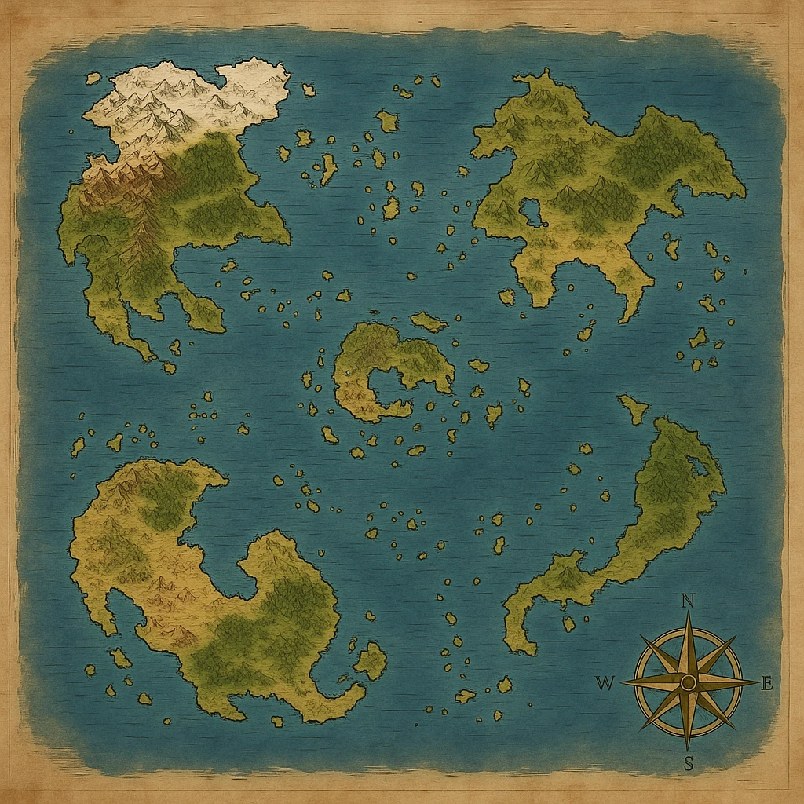

# Konzept

Ein Koop-Spiel zur D&D-Kampagne des Spielleiters. Langes Abenteuer mit
Spielständen; 2–4 Spieler. Inhalte (Geschichte, Homebrew-Klassen und
-Spezies) kommen nach und nach, wenn die Kampagne läuft.

## Die Welt

Ein Meer mit **fünf Kontinenten** und vielen kleinen Inseln dazwischen —
alle sollen bespielbar werden, nach und nach.

| Lage | Was die Karte zeigt | Name |
|---|---|---|
| Nordwesten | Schneegebirge im Norden, Gebirgszug nach Süden, Wälder, Halbinseln | offen |
| Nordosten | Hügel und Wälder, ein Binnensee im Westen, Halbinsel nach Süden | offen |
| Mitte | sichelförmige Insel um eine Bucht | offen |
| Südwesten | Steppe/Savanne im Westen, Wald im Osten, weit geschwungen | offen |
| Südosten | lang gestreckt, Wald, kleine Bucht im Norden | offen |

Die kleinen Inseln liegen grob in Ringen um die Mitte. Im Spiel stehen alle
als Regionen in `inhalte/daten/welt.json`; die **Startinsel** ist vorerst
`insel-047` (östlich-südöstlich des Nordwest-Kontinents, nördlich der
Sichel) — wenn eine andere gemeint ist, dort umtragen.

## Der Anfang (Kurzfassung des Spielleiters)

Die Gruppe startet auf einer **kleinen Insel südöstlich des großen
Nordwest-Kontinents**. Von dort geht es zu einer **Hafenstadt**, in der
seltsame Anomalien auftreten: **Dimensionsrisse**. Ganz normale Gassen
führen plötzlich an völlig andere Orte, z. B. einen Dschungeltempel wie am
Anfang von *Indiana Jones* oder eine Akropolis. Die Spieler reisen durch
die Risse und müssen die Stadt retten.

### Was das fürs Spiel heißt

- **Die Hafenstadt ist der Mittelpunkt** — wie Mabe Village in Link's
  Awakening oder Clock Town in Majora's Mask: man kommt immer wieder zurück,
  sie verändert sich mit dem Fortschritt.
- **Jeder Riss ist ein Übergang** in ein eigenes Gebiet mit eigenem Stil
  (Dschungeltempel, Akropolis, …) — im Grunde ein Dungeon. Das Gerüst dafür
  (Gebiete, Übergänge, Spielstand) steht schon.
- **Risse öffnen und schließen sich** mit dem Fortschritt. Dafür braucht es
  **Weltzustände** („Riss Tempel geschlossen", „Hafenmeister gerettet"), die
  im Spielstand stehen und von denen Übergänge, Figuren-Dialoge und Türen
  abhängen.
- Die Orte sind *angelehnt* an bekannte Vorbilder, aber selbst gestaltet —
  eigene Grafik, eigene Rätsel (ein rollender Felsbrocken im Tempel darf
  natürlich nicht fehlen).

## Das Setting (vom Spielleiter, 25.10.2026)

**Ton und Vorbilder:** eine Mischung aus *One Piece*, *Star Wars* und
*Gravity Falls*, dazu eine Prise *Warhammer 40k* für den Hintergrund und
für coole Technik.

**Kräfte:** Als Kräftesystem dienen
- **die Macht** aus *Star Wars*: Der Spielleiter hat alle beschriebenen
  Machtfähigkeiten recherchiert und eingeteilt. Diese Liste kommt noch.
- **eine eigene Spielart der Teufelsfrüchte** aus *One Piece*: Einzelheiten
  kommen noch.

**Vorgeschichte:**
1. Vor Tausenden von Jahren, im goldenen Zeitalter der Menschheit, lernte
   ein genialer Wissenschaftler, die **vier Grundkräfte des Universums** zu
   beherrschen. Die Macht verdarb ihn. Er stürzte die Galaxis in einen
   gewaltigen Krieg und wurde als **Nemroth** bekannt.
2. Ein mächtiger Krieger besiegte ihn schließlich und verbannte ihn in eine
   **Spiegeldimension**.
3. Der Krieg hatte die Galaxis zerstört. Die Menschen suchten sich eine neue
   Heimat und fanden einen geeigneten Planeten. Ein mächtiger
   **Terraformer** machte ihn bewohnbar.
4. Wegen des Geschehenen wurde **Technologie verbannt**. Die Menschheit fiel
   in ein eher mittelalterliches Zeitalter zurück und vergaß, woher sie
   einst kam.
5. Über die Jahrtausende veränderte der Terraformer die Lebewesen des
   Planeten, und es entstanden **neue Arten**. Auch die Macht und die
   Teufelsfrüchte bekommen ihre Kraft von diesem Gerät, das die Realität
   verändern kann.

**Jetzt:** Kultisten, Anhänger Nemroths, wollen ihn zurückholen. Die Spieler
müssen das verhindern. Es gibt noch Kleinigkeiten, die nach und nach kommen.

### Was das fürs Spiel heißen könnte (noch nicht entschieden)

- Das mittelalterliche Aussehen von Riftside und den Inseln passt. Technik
  wäre dann etwas Altes, Verbotenes: Fundstücke, Ruinen, Kultisten mit
  Geräten.
- Die Spezies im Spiel (bisher D&D-artig) könnten die „neuen Arten" des
  Terraformers werden. Was der Spielleiter dazu festlegt, ersetzt
  `spezies.json`.
- Klassen und Fähigkeiten (bisher Kämpfer, Schurke, Magier, Kleriker,
  Waldläufer) könnten sich nach Macht und Teufelsfrüchten richten, sobald
  die Einteilung da ist.
- **Ob die Dimensionsrisse mit Nemroth, der Spiegeldimension, dem
  Terraformer oder den Kultisten zusammenhängen, ist offen.** Das entscheidet
  der Spielleiter; nichts davon ist im Spiel eingebaut.

## Offene Fragen

- Namen der Kontinente und der Startinsel. (Die Hafenstadt heißt **Riftside**
  und liegt auf der Startinsel.)
- Welche Risse/Orte gibt es noch, und was „rettet" die Stadt? (Eingebaut:
  Fischergasse → Dschungeltempel mit Idol und Steinkugel, Seilergasse →
  Akropolis mit Plattenrätsel und Eule.)
- ~~Wie reist man zwischen den Inseln?~~ Mit Booten und Schiffen; man muss sich
  selbst mit Karte und Kompass orientieren (eingebaut: Ruderboot, Dunst,
  Kompass, Weltkarte ohne eigenen Punkt auf See).
- Homebrew-Klassen und -Spezies: die neuen Arten des Terraformers, die
  Einteilung der Machtfähigkeiten, die eigene Spielart der Teufelsfrüchte.
- Hängen die Risse mit Nemroth, der Spiegeldimension, dem Terraformer oder
  den Kultisten zusammen? Wo kommen Kultisten vor?
- ~~Gehören Schlüssel dem Finder oder der Gruppe?~~ Der Gruppe (gemeinsamer
  Schlüsselbund), vorerst.
